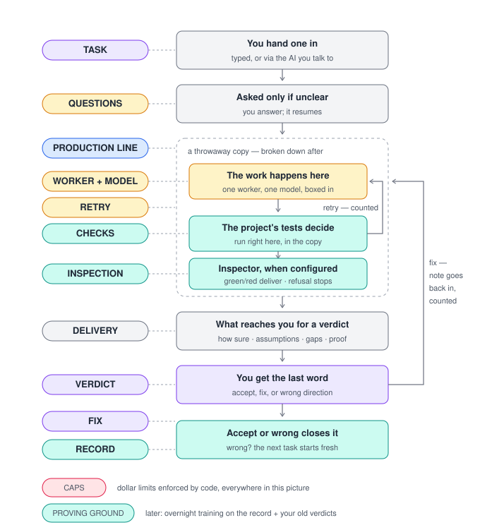

# Fábrica - Phase 1, in progress

The answer key was committed first. The tool is now being built against it.

- `CONTRACT.md` - the rules the tool can never break, in plain language.
- `contract/` - the same rules as runnable tests. This is the enforcement.
- `SPEC.md` - the blueprint for version one.
- `ROADMAP.md` - the path from here to Amy.
- `src/` - the tool itself, as far as it has been built.
- `skill/` - session setup for the AI you talk to, per harness. Templates
  you review and install by hand; nothing here installs itself.

To see the current state:

    npm install
    npm test

Expected today: **every contract test green**. `npm test` runs the
contract suite together with the tool's own tests; a red contract test
is a real regression, not an unbuilt part. Run the command yourself for
the exact tally, since the tool's own test count still moves with every
issue closed. This project is itself registered with Inspector, so every
task Fabrica runs against it hands that same suite to Inspector, which
runs it in its own container before any work is delivered.

Phase 1 has exactly one definition of done: every contract test turns green.

## Developing Fabrica itself

If you're changing Fabrica's own code rather than just using it, link
this checkout instead of installing a frozen copy:

    npm install
    npm link

`npm link` puts `fabrica` on your `PATH`, pointed at *this checkout's*
source files - there is no build step, it runs `src/`'s TypeScript
directly, so every edit, and every mid-merge conflict marker, is live
immediately. That's exactly backwards for anyone who isn't actively
editing this repo, which is why the global install below exists
instead: a frozen copy that can't break just because some checkout
somewhere is mid-edit. `npm unlink -g fabrica` undoes it.

## Installing the command

Prerequisites: **Node 24.18.0**, **git**, and **Docker** (Docker is only
needed to actually run a task - not for this install step itself). That
Node version is exact, not a floor: it is what `.node-version` holds, so
`fnm install`/`nvm install` in a checkout picks it up on their own, and
`package.json` declares it strictly enough that npm refuses to install
on a different one. It is the same version the check box and the Worker
container run, which is the point - `fabrica doctor` reports a mismatch
as a FAIL.

    d=$(mktemp -d) && git clone --depth 1 --branch master https://github.com/inactdev/fabrica.git "$d/fabrica" && (cd "$d/fabrica" && npm pack --pack-destination "$d") && npm install -g "$d"/fabrica-*.tgz

Three steps, so paste the whole line: clone the repository into a
throwaway directory, build the published tarball from inside that clone
(`npm pack`, which runs Fabrica's own build step - that is what records
the exact commit being installed, see `fabrica doctor` below), then
install that tarball globally. If your machine's default npm prefix is
read-only - a Nix-managed host, for one - add `--prefix <your prefix>`
to the last `npm install -g`.

**Not `npm install -g github:inactdev/fabrica`.** That one-liner does
install a working command, but npm fetches a GitHub spec as GitHub's
tarball of the tree, with no `.git` in it, so the build step has no way
to record which commit it just installed - and `fabrica doctor` then
reports `commit unknown`, which stops `fabrica up`. The clone above is
the whole difference. (It also sidesteps a second problem with that
form: on npm 11.16.0 it can leave the package a symlink into a clone npm
deletes straight afterwards, so the installed `fabrica` is "No such file
or directory" the first time you run it.)

If you have ever run `npm link` from a checkout of this repository, run
`npm unlink -g fabrica` first - that leftover symlink makes any global
install of `fabrica` fail with `ENOTDIR`, and `fabrica doctor` reports it
with the same fix.

That's the whole install. It puts a fixed, standalone copy of `fabrica`
on your `PATH`, working from any directory - verified against a real
install. Nothing under this command's control touches your shell profile
or any other file on the machine, and the throwaway directory is yours to
delete (`rm -rf "$d"`).

That installed copy is frozen: it does not change when some other
checkout of this repository changes, including one you are actively
editing, mid-merge, or on a branch - the problem that motivated this
install method. To upgrade later, run `fabrica update` (or the same
procedure again); `fabrica update` runs exactly those three steps for
you, reinstalling into the prefix this copy actually lives under - which
matters on a host whose default npm prefix is read-only - and brings the
installed Inspector and the live view forward with it. There is no
uninstall step beyond the ordinary `npm uninstall -g fabrica`.

**`npm link` is a separate, developer-only install**, documented above
under "Developing Fabrica itself" - it points the `fabrica` command at
a checkout's live source files, so every command breaks the moment that
checkout is mid-edit or mid-merge. Reach for the global install above
unless you are changing Fabrica's own code.

### Building the worker image

Running a task needs Docker: every Worker call runs inside a throwaway
container, built once from `src/brain/adapters/docker/Dockerfile`, and
every task's network goes through a relay container running a
digest-pinned stock image. You do not have to put either there
yourself:

    fabrica up          # builds and pulls whatever is missing, then starts your session
    fabrica doctor --fix   # the same, without starting a session

`fabrica up` does it unasked - it is about to run tasks - and reports
what it built. Plain `fabrica doctor` stays read-only: it tells you the
image is missing or out of date and prints the exact `docker build` /
`docker pull` command, which is the same command `--fix` runs (the
build command embeds a hash of the Dockerfile itself, which changes
over time - `doctor` is the one place that command is kept current,
rather than copied here where it would go stale).

A project that commits a `Dockerfile.inspector` gets a second, better
box: Fabrica builds **that project's own check image with the coding
agent layered on top**, tags it per project, and runs the Worker in it.
The point is that a Worker can then run the very tests covering what it
just touched - a Rails project's `bundle exec rspec` exists in its box
because the project's own image put it there - instead of writing blind
until Inspector judges it afterwards. The same two commands supply it,
and the same stamp decides when it is stale: the image is rebuilt when
either input changes, the project's `Dockerfile.inspector` or Fabrica's
own layer. A project committing no such file keeps the shared image
exactly as before.

That layer installs the coding agent, and the Node it runs on, off the
image's `PATH`, adding exactly one command to the box - so a project's
own node, ruby or go stays the one its checks run on, in the Worker's
box and in Inspector's alike. It needs `bash`, `git` and either `curl`
or `wget` in the project's image and refuses the build, naming what to
add to `Dockerfile.inspector`, when one is missing.

See `src/containment/README.md` for what the container confines,
`src/projectimage/README.md` for which image a project's Worker uses,
and `src/brain/adapters/claude-code.md` for how the coding agent's
credential reaches it - set up in the next section.

### The worker token

The coding agent that does the work needs its own credential, kept out
of your shell environment by default:

    claude setup-token

then put the printed token in `~/.fabrica/brain.env` as a single line:

    CLAUDE_CODE_OAUTH_TOKEN=<token>

and lock it down:

    chmod 600 ~/.fabrica/brain.env

`fabrica doctor` (below) checks for exactly this file and mode, and
never prints the token itself.

The token never reaches the Worker: its container sits on an isolated
Docker network with no route out, and every call it makes goes through
a relay Fabrica runs beside it, which swaps the throwaway placeholder
the Worker holds for the real token on its way to the provider (see
`src/relay/README.md`).

### The GitHub App

Fabrica pushes branches, opens pull requests, reads the issue a task
names, and reads the checks your repository runs on that pull request.
All four go through a GitHub App you own, which hands out a key that
expires an hour after it is minted and can only touch the one repository
the task is running on. There is no personal-token fallback: without the
App, a task refuses before it starts and tells you this.

Set it up once per machine. Run `fabrica doctor` after any step to see
where you are.

**1. Register the App.** Open
<https://github.com/settings/apps/new>. Name it anything. Leave the
callback URL and the webhook URL empty, and untick **Active** under
Webhook.

**2. Grant exactly these repository permissions, and nothing else:**

| permission | level | what it is for |
|---|---|---|
| Contents | Read and write | pushing the task branch |
| Pull requests | Read and write | opening and updating the pull request |
| Commit statuses | Read and write | posting Inspector's `inspector` stamp, and reading the checks on the pull request |
| Issues | Read-only | reading the issue a task names |
| Checks | Read-only | the same |
| Actions | Read-only | the log of a check that went red |

**Commit statuses** has to be **Read and write**, not Read-only: the
`inspector` commit status that gates every merge is posted with this
token. `fabrica doctor` now mints a real publishing token and checks what
GitHub granted on it, so a level that is too low is a FAIL that names the
setting — rather than four green tasks that cannot be published.

**3.** Under "Where can this GitHub App be installed?" choose **Only on
this account**, then **Create GitHub App**.

**4. Generate the key.** On the App's settings page, click **Generate a
private key**. A `.pem` file downloads. Move it somewhere only you can
read, and lock it down:

    mv ~/Downloads/*.private-key.pem ~/.fabrica/github-app.pem
    chmod 600 ~/.fabrica/github-app.pem

That mode is enforced, not advised: any other mode is refused by name.

**5. Copy the Client ID** from the same page (it starts with `Iv`).

**6. Tell Fabrica about both,** as two lines in
`~/.fabrica/brain.env` — the same 600-mode file the worker token lives
in:

    FABRICA_GITHUB_APP_ID=<the Client ID from step 5>
    FABRICA_GITHUB_APP_KEY=/Users/<you>/.fabrica/github-app.pem

    chmod 600 ~/.fabrica/brain.env

The second one is a *path to* the key, not the key itself.

**7. Install the App.** Back on its settings page, click **Install
App**, pick your account, and choose **Only select repositories** —
then select the repositories you run tasks on. Fabrica's own checks
fail if the App is not installed on a project you have registered.

If you ever widen a permission on an App that is already installed,
GitHub asks you to accept the change on the installation itself — it
emails you a link, or you can use **Configure**. Until you do, the
installation keeps the narrower set and tokens minted off it are still
short. That is the failure `fabrica doctor` is looking for.

**8. Remove the old token.** If `GITHUB_TOKEN` is still set in your
shell or sitting in `~/.fabrica/brain.env`, delete it and revoke it on
github.com. Nothing reads it any more. `fabrica doctor` warns while one
is still there.

Then `fabrica doctor`'s **github app** line should read `OK` and name
your App.

### When the App cannot be installed: a project with its own token

Some organizations will not let you install a GitHub App — a company
account, typically, where the decision is not yours. Such a project can
name its own token instead, and everything else about Fabrica is
unchanged.

**1. Make a fine-grained personal access token** on github.com, scoped
to that **one repository**, with these repository permissions: Contents
*Read and write*, Pull requests *Read and write*, Commit statuses *Read
and write*, Issues *Read-only*, Checks *Read-only*, Actions *Read-only*
— the same list the App is granted above, and for the same reasons.

**2. Put it in `~/.fabrica/brain.env`**, the same 600-mode file every
other credential on the machine lives in, under a name of your choosing:

    DAYJOB_GITHUB_TOKEN=github_pat_...

    chmod 600 ~/.fabrica/brain.env

**3. Name the variable — not the token — in the project's entry** in
`~/.fabrica/projects.toml`:

    [projects.dayjob]
    path           = "~/work/widgets"
    check          = "./check.sh"
    githubTokenVar = "DAYJOB_GITHUB_TOKEN"

Every GitHub operation for that project then goes through that token:
the push, the pull request, the issue a task names, and the checks on
the pull request. No App token is minted for it, and **it is never a
fallback in either direction** — a project either names a token or uses
the App. A machine where every registered project names its own token
needs no App configured at all, and `fabrica doctor` says so instead of
failing.

`fabrica doctor` reports which of the two each project uses on that
project's own line, and FAILs if the variable it names holds nothing or
if `brain.env` can be read by anyone else. It never prints the token.

One thing the App gives you that a personal token cannot: `fabrica
doctor` and `fabrica do` check an App token's *granted* permissions
before a task starts, which is how a token that can push but not stamp
is caught up front. GitHub exposes no equivalent for a personal token,
so for a project using one, a permission you forgot shows up as a failed
publish at the end of the round instead. Grant all six above and that
does not arise.

### When nothing may be added to the repository

The other half of a company repository: not just the credential, but the
files. Inspector normally reads three of them out of the repository root
— `.inspector.json`, the check script, and `Dockerfile.inspector` — and
posts a commit status on the pull request it opens. Where neither is
allowed, three project settings move all of it out of the way:

    [projects.dayjob]
    path                = "~/work/widgets"
    check               = "./check.sh"
    githubTokenVar      = "DAYJOB_GITHUB_TOKEN"
    terms               = "~/fabrica-terms/widgets"
    noStamp             = true
    pullRequestTemplate = true

**`terms`** is a folder on this machine — outside the repository, and
not inside a folder that contains it — holding those three files.
Inspector is handed the folder and mounts it read-only into the check
box; the repository stays exactly as it is, and Fabrica stops looking
for any of the three in it. Fabrica never writes into the folder, and
`fabrica register` never touches it: a work-mode project is registered
by hand. A relative path is read as relative to `projects.toml`.

**`noStamp = true`** means Inspector still pushes the branch and opens
or updates the pull request on a green result, but posts no commit
status at all. The publishing token stops asking GitHub for the
permission to post one, so an App or a personal token granted only
Contents and Pull requests is enough for such a project.

**`pullRequestTemplate = true`** makes the pull request body the
repository's own `.github/PULL_REQUEST_TEMPLATE.md`: the worker's Why,
What and How go under the template's own matching sections (Motivation,
Description, Changes, Testing and the obvious synonyms), whatever the
template already had under those headings is kept, and everything that
found no section — the rest of the write-up — is appended at the end
under one **Notes** heading. The commit message is unchanged either way.

`fabrica doctor` reports all three on that project's own line, FAILs if
the terms folder is one Inspector would refuse (missing, not a folder,
inside the repository, missing one of the two files it reads by name),
and says plainly when a project asks for its repository's template and
there is none to render into.

A project that carries none of these three behaves exactly as every
project did before they existed.

### Paying per token instead (optional)

The default Worker is the coding agent above, on the flat-rate
subscription you already have. If you want a different model - an
open-weight one, a hosted one you pay per token for, or one running on
your own machine - there is a second Worker that talks to any
OpenAI-compatible API directly. It **will not start without a per-task
spending cap** (`[caps].perTaskUsd`), and every dollar on its receipts
is the real figure the provider charged for the call.

Add to `~/.fabrica/brain.env` (same file, same `chmod 600`):

    FABRICA_BRAIN=openai-compatible
    FABRICA_MODEL=<the model id, exactly as your provider names it>
    OPENROUTER_API_KEY=<your key>

`FABRICA_MODEL` is the standing choice for this Worker; a single task's
own `fabrica do --model <name>`, or its project's `model` setting, wins
over it (see "Running a task"). Leave `FABRICA_BRAIN` out and nothing
changes. `fabrica doctor` then
reports which model at which endpoint, and `fabrica doctor --live`
spends a fraction of a cent to confirm it answers and reports its own
cost. To point it somewhere else entirely - a local server, say - set
`FABRICA_MODEL_BASE_URL`. See
`src/brain/adapters/openai-compatible.md` for every setting, what was
verified against which vendor document, and what still needs checking
on your own machine.

### `fabrica doctor`

    fabrica doctor

Run this after installing, and any time something seems wrong. It is a
preflight that spends nothing: one line per check - `OK`, or `FAIL` with
the exact fix - covering Node, which copy of `fabrica` you're actually
running (a developer checkout's branch and commit, or an installed
copy's version and commit, either way compared against the project's
`origin/master`), Docker, the worker image, the coding agent's version
installed inside it, the relay image every task's network goes through,
the worker token above, the GitHub App every push and pull request goes
through, Inspector itself, every project you've registered, your
spending caps, and any unmeasured spend blocking new work.
`fabrica doctor --live`
additionally spends a few cents to confirm the worker token actually
authenticates.

Each registered project also gets a second line naming the image its
Worker works in - its own `Dockerfile.inspector` with the coding agent
layered on top, or the shared image when it commits none - which `FAIL`s
when that image is missing or either input has changed since it was
built, and reports the agent's version installed inside it against the
pinned one.

`fabrica doctor --fix` additionally *supplies* those images rather
than only naming them: it builds the worker image when it is missing or
out of date, pulls the relay image when it is missing, builds each
project's own image when that line asks for it, and says what it
did. It only ever runs the command the failing line already printed -
the pins deciding "missing or out of date" are untouched - and the
report that follows describes the machine as it is afterwards. Without
`--fix`, doctor changes nothing, as it always did. (`fabrica up` does
this step unasked; see below.)

Every `FAIL` here is worth fixing, but they are not all equally urgent,
and `fabrica up` treats them differently: it refuses to start a session
only over a finding that makes a task *impossible* and that it could
not supply itself - no Docker, no token, a project folder gone - and prints the rest as
`WARN` lines above the session, with their fixes, before starting it
anyway. Today those are the **checkout** line (an installed copy that
cannot say which commit it is, a developer checkout off `master`, or
either one behind `origin/master`) and a leftover `npm link` symlink:
which copy of `fabrica` is on the disk, and whether it is the newest
one, stops no task from running.

On a Mac, `fabrica up` doesn't even report Docker not running - it runs
`open -a Docker` for you and waits up to two minutes for the daemon,
saying what it's waiting on, before any check asks. In the same spirit,
it doesn't report a missing or out-of-date **worker image**, a missing
**relay image**, or a project's own missing **machine image** either: it
builds and pulls them, printing docker's own output as it goes and one
line per image saying what it did, and only refuses if that genuinely
failed.

The **inspector** line also reports which build of Inspector you have:
the commit the installed binary was built from, against the tip of
Inspector's own `main`. A binary behind `main` is a `FAIL`, and the fix
is the exact command that replaces it, pinned to that commit - run it
and the line goes green. Behind means behind: a commit *ahead* of
`main`, or one built from a branch, passes with that said, and so does a
binary you built yourself from a checkout, one whose commit can't be
read, and a run that can't reach GitHub at all (no network is not a
stale binary).

The **github app** line is the one above: it fails if no App is
configured, if its key is at the wrong mode or GitHub rejects it, if the
App is installed nowhere, or if it is not installed on a repository you
have registered as a project — and it carries the fix for each. It
warns, without failing, while a personal `GITHUB_TOKEN` is still in
Fabrica's configuration. It asks nothing about a project that reaches
GitHub with its own token, and when every registered project does, the
line passes with no App configured at all.

Each **project** line ends with which GitHub credential that project
uses — the App, or its own token, named by the variable holding it. A
named variable that holds nothing, or a `brain.env` anyone else can
read, is a `FAIL` there: nothing that project works on could be
published.

Two of those lines are about the network a Worker gets. **relay image**
fails if the image the relay container runs from isn't on the machine -
no task can start its relay without it - and prints the exact `docker
pull`. **worker CLI** reports the coding agent's version as actually
installed in the worker image against the version the Dockerfile pins,
and only fails when those two disagree.

### Installing Inspector (optional)

Inspector independently checks and can publish a Worker's green work
(see "If the task's base commit contains `.inspector.json`" below). It
is a separate Go tool, not an npm package:

    go install github.com/inactdev/inspector/cmd/inspector@latest

This needs **Go 1.22+**, and puts `inspector` wherever `go install`
puts binaries on your machine (make sure that's on `PATH`). Without it
installed, a project that carries an `.inspector.json` is self-tested
in the Worker's own box instead - but `fabrica register` writes that
file into every project it sets up, and `fabrica do` refuses a project
whose base commit has none, so in practice this step is worth doing.
Keep it current the same way: `fabrica doctor`'s **inspector** line
fails once the installed binary is behind Inspector's `main` and prints
the `go install` that catches it up. Reading the installed binary's own
commit uses `go version -m`, so leaving Go on `PATH` after the install
is what lets that line say anything; without it the line reports that
and passes.
See `src/inspector/README.md` for the publishing boundary.

You only run that command by hand once. After that, `fabrica update`
keeps Inspector current along with Fabrica itself - it installs the tip
of Inspector's own `main` whenever the installed one is behind it, or
when none is installed at all - and `fabrica doctor` FAILs on a stale
one, printing the exact command to fix it. An Inspector you built
yourself (from a branch, or from a local source tree) is reported as
that and left alone, never replaced.

## Registering a project

Once per project, before its first task:

    fabrica register <path> --check "<command>" --image <docker image>

`<path>` is the repository's own root, and it needs an `origin`. The
command is the one thing that must pass for work on that project to be
green; the image is what it runs inside, here and for every later task
(Fabrica never runs a project's check on your machine).

It writes a `check.sh` holding that command, an `.inspector.json`
naming it, and a `Dockerfile.inspector` with that image on its `FROM`
line - the file Inspector builds the check box from. Then it runs the
check once inside the image, and - only if it passes - commits, pushes a
`fabrica/register` branch with your own git credentials, and opens a
pull request with `gh pr create` for **you** to merge. Then it appends
the project to `~/.fabrica/projects.toml`:

    [projects.spending-app]
    path = "/Users/you/inkling-umbrella/spending-app"
    check = "./check.sh"
    onlyTouchedTests = true

A `model = "<name>"` line here is this project's standing model choice
for its Workers - see "Running a task" below; without one, the worker's
own configuration decides.

`onlyTouchedTests` is the standing instruction every Worker on this
project is given: run the tests covering what you touched, not the
whole suite - the project's check runs in full after the Worker is
done either way, so running everything twice only costs time. It is on
for every project, including ones registered before this existed; set
it to `false` here to turn it off for good, or say "run the full suite"
in a task's own text to turn it off for that one task.

### Telling Fabrica which tests cover what

`onlyTouchedTests` leaves a Worker to work out for itself which tests
cover what it touched. A project can say so instead:

    fabrica tests-map

in the project's own folder writes a `tests.map` in its root - one
entry per line, a glob pattern, a colon, then comma-separated test
files or commands:

    src/foreman/do.ts: src/foreman/do.test.ts
    src/cli/*.ts: npm test -- src/cli

It is generated from the colocated `foo.ts` / `foo.test.ts` convention,
and **meant to be edited by hand afterwards** - a source file with no
colocated test of its own is left out, so add a line for it when you
know what covers it. Re-running the command needs `--force` and throws
your edits away. Commit the file.

Once it is there, every task on that project tells its Worker to run
exactly the tests its touched files map to - the union of every pattern
each file matches - stop and fix a failure there, and only then run the
whole suite the way your check runs it. Each delivery records which of
those mapped tests the Worker says it ran (its own report, marked as
such - the full-suite run is what actually checks the work), every
touched file the map covers with nothing, and any mapping naming a test
file the project no longer has. `fabrica status` names the gaps on the
task's own line: nothing is skipped quietly, and nothing fails over a
missing mapping either.

Like `fabrica up` and `fabrica update`, this one is denied to the AI you
chat with - it writes a file into your checkout, which only you should
be doing.

Everything that can refuse refuses before anything is created: a path
that isn't a repository, a missing `origin`, a `gh` that isn't logged
in, a stopped Docker daemon, a `fabrica/register` branch that already
exists, or a project already registered. A failing check refuses too,
with its output - nothing is pushed. It needs `gh` (logged in) and
Docker; `--protected <glob,...>` adds paths a Worker may never quietly
change, on top of `check.sh`, `.inspector.json` and
`Dockerfile.inspector`, which always are.

**The check box has no network.** Whatever the check needs is installed
in `Dockerfile.inspector`, at build time, or already ships in the image:
a project with a `package-lock.json` gets `npm ci` there (and a
`check.sh` that links the result in), one with a `go.sum` gets `go mod
download`, and anything else gets a comment in that file naming what
still has to be installed - never a silent gap. A repository that
already carries its own `Dockerfile.inspector` keeps it, untouched:
`fabrica register` never overwrites a committed file.

One more flag describes the box the check runs in later, and goes into
`.inspector.json`: `--timeout <seconds>`, if the check needs longer than
Inspector's own default. It is off unless you pass it.

This is the one Fabrica command that pushes, and it is allowed to
because of what it is: it runs as you, on your machine, with your own
credentials, and the only thing it ever puts on origin is a branch you
still have to merge. It never merges, never force-pushes, never touches
an existing branch, and never runs inside a Worker.

If the repository already has `.inspector.json` on origin's default
branch, it is set up already - only the `projects.toml` entry is added,
and `--check`/`--image` aren't needed.

### If you don't know what to put in `.inspector.json`

Leave both flags off and Fabrica proposes the file, from what the
repository already says - an existing `check.sh`, `package.json`'s
scripts and `engines`, `go.mod`:

    fabrica register <path> > <path>/.inspector.json

The proposed document is the **only** thing on stdout, so that redirect
writes exactly it. Every field's reasoning goes to stderr instead, one
line per field, along with any disagreement between two signals (an
existing `check.sh` always wins one, and the disagreement is named
rather than dropped) - and so does a proposed `Dockerfile.inspector` to
commit next to it, since the config names no image any more and the
check box is built from that file. It is deliberately not on stdout:
that stream is the one document the redirect writes.

It **prints the files and never writes them**, and exits non-zero,
because nothing was written and nothing was registered. Read them,
replace anything marked `REPLACE-ME-with-...` (the image is the one
field no repository usually names; the placeholder is a deliberately
invalid Docker reference, so it cannot be committed by accident), commit
them yourself, and run `fabrica register <path>` again.

That asymmetry is on purpose: `.inspector.json` is the file deciding how
Fabrica's own work is judged, so Fabrica never puts it in your
repository unasked. The `--check`/`--image` route above does write it -
onto a branch, in a pull request you review before it merges.

### If you can't commit those files at all: `--terms <folder>`

A day job's repository takes no `.inspector.json`, no `check.sh` and no
`Dockerfile.inspector` - there is no pull request to open for them. So
name a folder of your own instead:

    fabrica register <path> --terms ~/fabrica-terms/widgets

The same three files, derived the same way from what the repository
already says, are written into that folder, and the project is
registered pointing at it (`terms = "..."`, plus `noStamp = true`: no
`inspector` commit status is expected for a repository nothing of yours
is keyed on). **The repository is read and nothing more** - no branch,
no commit, no pull request, so `gh` and Docker are not needed either.

A file already in the folder is kept exactly as it is and only what is
missing is written, so running it again after editing by hand is safe.
Three things it tells you rather than leaving you to find out:

- **Nothing is proven.** Unlike the route that writes into the
  repository, this one runs no check - the `FROM` line is usually still
  a `REPLACE-ME-with-...` placeholder. Read all three files and finish
  them.
- **`check.sh` is not written when your repository already has one.**
  That file is what `./check.sh` means; a second copy beside it would be
  a silent fork.
- **The two settings start working at the next task, not now.** From
  then on `fabrica do` reads the folder instead of the repository and
  Inspector is handed it, so a `REPLACE-ME-with-...` still sitting in
  one of the three files is that task's refusal. Finish them first.

Use `--terms` on its own: it refuses `--check`, `--image`, `--timeout`
and `--protected`, which only describe the route that writes into the
repository, rather than accepting one and quietly ignoring it. A
repository Fabrica cannot commit to usually also needs its own GitHub
token - `githubTokenVar = "<NAME>"` on the same entry, naming the
`brain.env` variable holding it.

## Running a task

    fabrica do "<task text>" --project <path-or-name> [--model <name>]

Prints the new task's id and returns immediately; the work continues in
the background (`src/cli/README.md` has the full design). `--project`
takes either a plain filesystem path, or the name of a project already
registered in `~/.fabrica/projects.toml` (see "Registering a project"
above).

`--model` asks this one task's worker for a particular model, named in
the worker's own vocabulary (an alias or a full model id) - a smaller,
cheaper one for a small task, say. A project that always wants one says
so once instead, in its own `projects.toml` entry:

    [projects.spending-app]
    model = "<the model this project's workers ask for>"

The flag wins over that setting, and with neither the worker's own
configuration decides. Whichever way it went, the choice and where it
came from are recorded on every one of the task's receipts, beside the
model that actually ran - and both are shown on the task's row by
`fabrica status`. Every later round of the same task - a
clarification you answer, a `fix` verdict - runs the model the task was
registered with, not whatever the default happens to be by then.

A project whose base commit - origin's default branch, which is where
every task's branch is cut from - carries no `.inspector.json` is
refused right here, before the task is registered at all:

    this project isn't set up for Fabrica yet: run fabrica register
    <path> --check ... --image ...

There is nothing in that commit saying how the work should be checked,
so there is no verified work to be had; refusing before anything starts
is what makes that cost nothing.

If the task is ambiguous enough that the answer would change what gets
built, nothing is started: you get one question instead - with two to
four options plus "other" - and one round to answer it.

    fabrica answer <id> --option <n>
    fabrica answer <id> -m "<text>"          # "other", in your own words

That folds your answer into the brief and runs the task, this time in
the foreground.

Every question carries an id, and the first answer to it wins: a round
retried after a failure is never asked the same thing twice. To change
an answer you already gave, name its question - `fabrica answer <id>
--question <qid> -m "<text>"`. The record keeps both answers, the newer
one applies to the task's later rounds, and nothing is rewritten.

If the task's base commit contains `.inspector.json`, a green Fabrica
check triggers Inspector before delivery. Fabrica never pushes the
branch itself: Inspector may publish green work, returns red work with a
report for your verdict, and records a refusal without creating a
Client delivery. See `src/inspector/README.md` for the publishing
boundary and the current compatibility limitation.

## Notes from a knowledge base in every brief

A project can name notes it keeps in a knowledge base - a separate
repository with a `notes/` folder in it - and every Worker on that
project is handed them in full, in every brief, without you retyping
anything into a task:

    [projects.spending-app]
    path = "/Users/you/inkling-umbrella/spending-app"
    check = "./check.sh"

    [projects.spending-app.knowledge]
    path = "../inkling-umbrella/knowledge-base"
    notes = ["worker-boxes", "money-rounding"]

`path` is the knowledge base's own folder. Written relative, it is
relative to `projects.toml` itself, not to wherever you happen to run
`fabrica` from; a leading `~` works here like anywhere else. Nothing is
fetched over the network - the files are read off your disk, as they are
at the moment each brief is built, so a note you correct between rounds
is the note the next round reads.

`notes` names them by their bare names, flat: `"worker-boxes"` is
`<path>/notes/worker-boxes.md`. No subfolders, and no `.md` in the name -
either is refused when the registry is read, rather than looked for
somewhere nobody meant. Each note needs a `title:` in its own front
matter: that title becomes the heading its words sit under in the brief,
after the task's own text.

Anything missing fails the task immediately, before a branch is cut and
before anything is spent, naming what is missing - a knowledge base that
isn't there, a `notes/` folder that isn't there, a note with no file, a
note with no title. A note is carried whole or not at all: nothing is
ever shortened to fit, so a brief that would be too big with the notes in
it is refused too, naming the notes and by how much.

## Who reviews the tests

Inspector can judge a change's *test* edits with a model, not just run
them - a project turns that on by listing its test files as `testPaths`
in its own `.inspector.json`. That needs a model, and Fabrica names it.
Put one in `~/.fabrica/projects.toml`:

    [reviewer]
    vendor = "<the reviewing vendor>"
    model  = "<that vendor's model>"

and its key in `~/.fabrica/brain.env` - the same 600-mode file the
worker's own token lives in - as a single line:

    <VENDOR>_API_KEY=<the key>

spelling `<VENDOR>` in capitals (vendor `acme` reads `ACME_API_KEY`). If
that vendor needs a base URL, add `<VENDOR>_BASE_URL` the same way;
Fabrica forwards it when it is there and never insists on it. Either
value may be set in the environment instead, which wins over the file.

One project can have a reviewer of its own, which replaces the global
one for that project:

    [projects.spending-app.reviewer]
    vendor = "<a different one>"
    model  = "<that vendor's model>"

**The reviewer must never be the worker's own vendor.** A model from the
same house as the one that wrote the code is not an independent review,
and Fabrica refuses outright rather than letting it happen quietly,
naming both vendors when it does.

Two other things are refused the same way - up front, by `fabrica do`,
before any worker runs or a cent is spent, with the reason on stderr and
nothing registered: a project that declares `testPaths` with no
`[reviewer]` configured at all, and a reviewer whose `<VENDOR>_API_KEY`
is nowhere to be found. A project that declares no `testPaths` needs no
reviewer and is unaffected by any of this.

## Who reads the diff

Once Inspector has turned a change green, its **whole diff** is read by
a second model whose only job is to flag what you should look at. It is
not a gate: it cannot stop a change and it cannot approve one. Anything
it flags goes straight back to the same worker as one more pass, before
the task is ever delivered to you - so by the time you see a delivery,
the easy findings have usually already been dealt with, and the ones the
worker disagreed with come with its written reason beside them.

Every task is read. So unlike the reviewer above, this one is required
whatever a project's `.inspector.json` says. Name it in
`~/.fabrica/projects.toml`:

    [reader]
    vendor = "<the reading vendor>"
    model  = "<that vendor's model>"

and, in `~/.fabrica/brain.env`, **both** of:

    <VENDOR>_API_KEY=<the key>
    <VENDOR>_BASE_URL=<that vendor's endpoint, without /chat/completions>

The base URL is required here, where it is optional for a reviewer, for
one reason: Fabrica makes this call itself rather than handing it to
Inspector, and it keeps no table of which vendor lives at which address.
Either value may be set in the environment instead, which wins over the
file.

### A reader with no API key at all

On a machine whose only model access is a coding-agent CLI on a
subscription - a work laptop, typically, where there is no API key to be
had and no account to put one on - name the harness as the vendor
instead:

    [reader]
    vendor = "claude-code"
    model  = "sonnet"

That reader's calls go through the `claude` command already installed and
signed in on the machine, so it needs **no `<VENDOR>_API_KEY` and no
`<VENDOR>_BASE_URL`** - nothing in `brain.env` at all. The model name
still comes from this table, exactly as for every other vendor, and
everything downstream is identical: the same findings, handed back to the
same worker as one more pass, on the same record and the same delivery.

The one thing that can be missing is the command itself. `fabrica do`
refuses up front, naming it, when `claude` is not on `PATH` - or when it
is there but not executable, which gets its own message naming the file
and the `chmod` instead of telling you to install what you already have.

This is one more way to reach a model, never a default: a reader is only
ever the vendor you named.

One project can have a reader of its own, replacing the global one for
that project:

    [projects.spending-app.reader]
    vendor = "<a different one>"
    model  = "<that vendor's model>"

`[reader]` is **never** taken from `[reviewer]`. They are two different
jobs - one judges a change's test edits inside Inspector's own run, the
other reads the whole diff afterwards and only flags - so you name each
one yourself, and you can give them to different models.

`fabrica do` refuses before anything is registered, and before a cent is
spent, if a project has no reader, no key for it, no endpoint to send the
call to, or - for a reader reached by a command - no such command on
`PATH` - printing the exact lines to add. (This is the one new
reason a `fabrica do` that used to work on a record home with no
`projects.toml` at all now stops: the reader is named in that file.)

A reader that cannot run **never blocks a delivery** - a flagger that
became a gate by failing would be the worst of both. It is never quiet
about it either: the failure lands on the task's record, on its
`fabrica status` row, in its delivery, and in one counted line at the
bottom of `fabrica status`:

    code reads that failed, on record: 3 (see `fabrica log <id>` for each)

While it runs, you can see where it stands without opening a record file
yourself:

    fabrica status         # every open task: id, project, state, age
    fabrica log <id>       # one task's event history (--transcript for the raw output)
    fabrica watch <id>     # follow that task while it runs
    fabrica shadow-report  # what your skip rules would have done (shadow only)

Every `status` row also names the model that did the work - the real one
the worker reported running, read off that attempt's own receipt, not a
placeholder. A task that asked for a particular model shows that
declaration beside it ("model: small-5 (declared via --model)"), so a
worker that ran something else is visible rather than assumed; a task
whose first attempt has not reported one yet reads "not reported yet".
`fabrica log <id>` says the same thing twice over: once where the round
starts, naming what it asked for, and once per attempt, naming what
actually ran beside what it cost.

`status` flags a delivered task as waiting on your verdict, shows a task
that is running its check with how long it has been at it, and calls a
working task that has recorded nothing for a while quiet - silence never
gets to look like progress. A task that failed before any work started
stays on the list, marked "FAILED, UNRESOLVABLE" and sorted below the
tasks still moving, so it neither disappears nor looks live. An Inspector
refusal means no verdict was reached: it is shown separately, never as
working or failed, and points to `fabrica log <id>` for the reason.
`watch` follows one task the same way: heartbeats appear live, and the
worker's own transcript arrives in a batch at the end of each attempt.
Stopping `watch` (Ctrl-C) stops only the watching; the work runs on in
its own process.

When the work comes back, you get the last word:

    fabrica verdict <id> <accept|fix|wrong> [-m "<note>"]

`accept` and `wrong` close the task. `fix` keeps it open and hands your
note back to the same worker on the same branch - unlimited, but
counted, so each round reports which one it is (`src/foreman/README.md`
has the exact rules).

Set `FABRICA_HOME` to use a record home other than `~/.fabrica`. Run
`fabrica --help` or `fabrica <command> --help` for the rest.

## Skip rules — recording only, for now

You cannot be the verdict on every task forever. But a task must never
skip you because the last ten went well, and you should never have to
write the rule that lets one through. So a project can commit a file,
`.fabrica/skip-rules.toml`, naming kinds of change and the yes-or-no
questions a program answers about each finished task:

    version = 1

    [kinds.docs-only]
    description = "A documentation-only change under docs/"
    mode = "shadow"
    allowedFolders = ["docs"]
    maxFiles = 5
    maxLines = 80
    noTestFiles = true
    noDependencyManifest = true
    inspectorGreen = true
    requiredGreenChecks = ["inspector-tests"]
    noQuestionsAsked = true
    noCouldNotVerify = true

The vocabulary of questions is fixed in Fabrica's own code - a line can
only combine them, never invent one or redefine what one means. Every
answer comes from the record and from the change's own diff; **no model
is consulted anywhere in this decision.** A model's finding reaches it
only as "did a check go red", so a model can send a task to you and can
never let one skip you.

**Nothing closes by rule today.** `mode = "live"` is refused, naming
CONTRACT rule 6, which is yours to amend before live mode is built at
all. What runs now is shadow mode: after every delivery, each line is
evaluated and the answer is written to the record - which kind would
have closed the task, every condition, every answer, the rule file's own
version and the change's fingerprint - and then the task comes to you
exactly as it always did.

    fabrica shadow-report

shows the case for (or against) each line: how many tasks it would have
closed, how many of those you then accepted, how many you ruled `fix` or
`wrong`, and how long it has been recording. `fabrica status` and the
live view's header carry the same counts in one line. A project with no
rules file is simply never evaluated and records nothing.

## Money limits

`~/.fabrica/projects.toml` can carry a `[caps]` table:

    [caps]
    perTaskUsd = 5
    perDayUsd  = 25

`perTaskUsd` caps what a single task may spend in total, counting every
attempt, resume, and fix round on it. `perDayUsd` caps spend across all
tasks. Either field may be omitted; an omitted field has no cap. With
no `[caps]` table at all, nothing is capped.

The daily cap is a **rolling 24 hours**, not a calendar day: spend ages
out exactly 24 hours after the attempt that incurred it started, not at
midnight, so there is no single moment a full day's budget returns at
once.

If any attempt's real cost could not be read, it is never treated as
free - `fabrica status` opens with `SPEND UNKNOWN - tasks blocked`, and
while a cap is set, that block refuses every new task, resume, and fix
round, however old the unmeasured attempt is. Only the owner can clear
it, by looking up the real figure and recording it by hand with
`fabrica cost <taskId> <usd>`; it is the one way out, and it is denied
to the AI you talk to for the same reason `fabrica verdict` and
`fabrica answer` are.

## Subscription limits

Money caps cannot see a flat-rate subscription: filling a week's quota
costs nothing, so a task can run the whole week down without a cent of
metered spend appearing anywhere. So the two meters the model provider
reports - how much of its **5-hour** and **7-day** windows the account
has used - are recorded on every receipt and shown by `fabrica status`
and the phone review page:

    subscription meters: 5h 7%, 7d 64% (new work stops above 70% of the week, running work above 90%)

and a plain pause rule, in its own `projects.toml` table, decides what
to do about them:

    [pause]
    sevenDayRefusePercent = 70   # above this, no new work starts
    sevenDayStopPercent   = 90   # above this, work already running is stopped
    fiveHourRefusePercent = 90   # above this, no new work starts

Those are the defaults; with no `[pause]` table at all, they still
apply. The 7-day window is the one that stops work already in flight -
the 5-hour one refills within hours, so stopping a running attempt for
it would throw away more than it saves. A task stopped this way is
**not** a failure: it is delivered as `paused-by-meter`, says so on
`fabrica status`, and waits for you - nothing restarts by itself. Give
it a `fabrica verdict <id> fix` once the window has rolled forward, or
raise the threshold to continue now.

If the meters cannot be read - no reading yet, or the last one is over
an hour old - nothing is refused and `fabrica status` says exactly
that. A number nobody could read never stops work.

The dollar caps above are unchanged by any of this, and still bind on
real, metered spend only.

## What a task may reach on the network

A Worker's container has no route to the internet at all. Everything it
sends goes through a relay Fabrica runs beside it, and the relay turns
away anything the project didn't ask for. Out of the box that means the
model provider and GitHub - nothing else.

A project that needs more says so in its own entry in
`~/.fabrica/projects.toml`:

    [projects.spending-app]
    path = "/Users/you/inkling-umbrella/spending-app"
    check = "./check.sh"
    hosts = ["registry.npmjs.org"]

`hosts` is **added to** the model provider and GitHub, never a
replacement for them, so listing a registry can't accidentally cut a
task off from the things every task needs. An entry is a host name,
optionally with one port (`"example.com:8443"`), optionally with a
leading `*.` to cover one level of subdomain (`"*.example.com"` covers
`api.example.com`, not `example.com` itself - list both if you need
both). A host the project never listed is refused, and the refusal is
on that task's own record with the host named: `fabrica log <id>`.

This is what a check that installs its own dependencies needs. With
`registry.npmjs.org` listed, `npm ci` inside the Worker's box works;
without it, it is refused.

Two limits apply to the same traffic, both overridable in the same
place:

    maxRequestBytes = 10485760   # default: 10 MB, per request
    maxCallsPerTask = 2000       # default: 2000 calls, per task

Going over either refuses that one request - and nothing more. The task
keeps running: your spending cap is the only thing that stops a task.

## Stopping the AI you talk to from editing files or ruling for you

Install the session config for your harness by hand to stop the AI you
talk to from editing files at all, and from running `fabrica verdict` or
`fabrica answer` - the two commands that record your own judgment.
`skill/claude-code/README.md` has the steps, what is verified, and the
limits of the verdict/answer half. Then, from the directory you installed
it into:

    fabrica verify-hook

It asks your chat agent, right now and with no permission bypass, to
create a throwaway file there, and reports whether the edit was denied
and whether the attempt was recorded - so "is this working" is something
you prove rather than assume.
